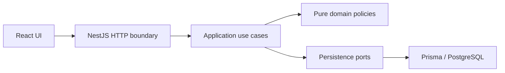

# 1. Title and one-liner

**KJBN Clinic Appointment Scheduler — Problem 2.** Scheduling for a two-doctor
clinic using React, NestJS, PostgreSQL, and Prisma. M2 scheduling rules and protected
application use cases are verified; their HTTP endpoints and UI remain M3/M4.

## 2. Live links

No public deployment yet. Container UI: http://localhost:8080; Vite UI:
http://localhost:5173. Local backend:
http://localhost:3000. API documentation and cold-start measurements are pending M3/M5.

## 3. Tech stack

TypeScript, React 19/Vite, NestJS 11, Prisma ORM 7, PostgreSQL, npm lockfiles.
Use Node.js 24 LTS and npm. PostgreSQL stores instants with timezone and local
calendar concepts separately. Hosting has not been selected.

## 4. Architecture



M2 implements the use cases, policies and persistence boundary; HTTP/UI remain M3/M4.
`appointments/application/` owns booking, cancellation, final status, atomic
rescheduling and advisory free slots. `availability/` owns availability edits;
`doctors/` owns protected doctor-setting edits. Pure domain policies depend only on
explicit types and small ports; Nest modules bind them to Prisma and an injected clock.
All scheduling writes share a PostgreSQL transaction lock. See
[M2 verification and design](docs/m2-verification.md).
`frontend/` and `backend/` share one root Git repository and `.gitignore`.
`backend/src/common/config/` initializes a validated, injected `AppConfig` from
process variables and `backend/.env`. Prisma owns connection lifecycle. Domain
code must not read environment variables or import NestJS/Prisma.

## 5. Running locally

Prerequisites: Node.js 24 LTS, npm, PostgreSQL, and (for containers) Docker Compose v2.

### Containers (from the project root)

```sh
cp .env.example .env
# Set your local PostgreSQL password and optional host ports in .env.
docker compose up --build -d
# Seed is explicit; normal startup only migrates.
./scripts/migrate-and-seed.sh
```

The UI runs at http://localhost:8080 and proxies `/api/` to the backend; the backend
is also available at http://localhost:3000. PostgreSQL stays on the private Compose
network and persists in the `postgres-data` volume. Root Compose settings and
`backend/.env` are separate: containers receive settings directly from Compose.
Use URL-safe characters for root `POSTGRES_USER`, `POSTGRES_PASSWORD`, and
`POSTGRES_DB`, since Compose builds the database URL from these values. Changing
credentials on an existing PostgreSQL volume does not change the stored database
role password; keep settings consistent or manage that password explicitly.

Images are tagged `dharaneesh2574/kjbn-frontend:latest`,
`dharaneesh2574/kjbn-backend:latest`, and
`dharaneesh2574/kjbn-backend:latest-tooling`. `IMAGE_TAG` changes their tags. The
tooling image holds the Prisma CLI/seed/tests; the non-root backend runtime holds
only production dependencies and compiled code. Frontend nginx also runs without
root. The migration job waits for healthy PostgreSQL; backend startup waits for
successful migration; frontend startup waits for the backend HTTP check.

`docker compose down` stops the stack and keeps the database volume. Rebuild after
code changes with `docker compose up --build -d`. Do not delete volumes to perform
routine upgrades. Example-only verification may use `--env-file .env.example`;
normal development uses the private `.env` you created.

### Native development

```sh
cd backend
cp .env.example .env
# Replace DATABASE_URL with your PostgreSQL credentials.
npm ci
npm run prisma:deploy
npm run prisma:seed
npm run build
npm run start:dev
```

In another terminal:

```sh
cd frontend
cp .env.example .env
npm ci
npm run dev
```

Backend variables: `DATABASE_URL` (required PostgreSQL URL), `PORT` (default 3000),
`NODE_ENV` (development/test/production), `CORS_ORIGINS` (comma-separated explicit
HTTP(S) origins), `REVIEW_MODE` (true/false, default false). Clinic timezone is
Asia/Kolkata. Frontend `VITE_API_BASE_URL` is public build-time configuration;
UI integration is pending M4. Never put secrets in Vite variables. Process
variables take precedence over `.env`; invalid configuration prevents startup
without logging credentials. Run backend commands from `backend/`.

`prisma:deploy` applies the committed SQL migration; `prisma:seed` explicitly
inserts the fictional catalog without deleting or overwriting existing records.
See [domain-model notes](docs/domain-model.md) for entities and seed cases.
For local database tests, set `TEST_DATABASE_URL` to an isolated database whose
name starts with `kjbn_test_`, then run `npm run test:integration` in `backend/`.
The suite applies migrations and removes only its own test fixtures.

## 5a. Deployment

No hosting provider or public deployment yet. Local Docker verification is a
subset of M5 explicitly requested early; hosted deployment, dedicated readiness,
and CI remain pending. `docker-compose.yml`, service Dockerfiles, and
`scripts/migrate-and-seed.sh` are the local build/migrate/seed path. Re-seeding is
explicit and preserves catalog edits. Prisma generation runs after install and
before build. OpenSSL and Prisma engine preparation are included in the tooling
image for reliable migration execution. PostgreSQL must support `btree_gist`.

The app images are built/tagged locally, not published to Docker Hub. Publishing
can be performed separately after `docker login` with
`docker compose push frontend backend migrate`; base PostgreSQL/nginx images remain upstream images.
Do not use the local example credentials for a hosted deployment.

## 6. Running tests and coverage

```sh
cd backend
npm run build
npm test -- --runInBand
npm run test:e2e -- --runInBand
npm run test:cov -- --runInBand
```

Read-only lint: `npx eslint src test prisma.config.ts prisma/seed.ts`.
`npx tsc --noEmit --incremental false` also checks test/seed types. Frontend checks
remain `npm run lint` and `npm run build` from `frontend/`.

`npm test` runs 99 tests, including 74 executable R1–R7 acceptance cases; there are
no remaining acceptance TODOs. `npm run test:rules` runs only those 74 cases.
`npm run test:integration` runs 30 real-PostgreSQL migration, constraint, seed,
application concurrency and rollback tests against isolated `TEST_DATABASE_URL`
(database name must start with `kjbn_test_`). `test:e2e` is currently the scaffold
HTTP smoke test with a mocked database; core API tests arrive in M3.

One command runs all current suites from `backend/` with the isolated URL set:

```sh
npm run test:all
```

Or from the root without native PostgreSQL (example credentials are test-only):

```sh
docker compose --env-file .env.example --profile test run --build --rm integration npm run test:all
```

The full gate passes 99 unit/acceptance, 1 HTTP smoke and 30 real-DB tests. Docker
uses a separate `kjbn_test_m1` database on tmpfs, never the application's named
volume. Use `docker compose --env-file .env.example stop test-db` afterward.
Integration suites deploy the committed migration and remove their own fixtures;
seed tests use only this isolated database. Jest VM modules support Prisma's dynamic
imports. No tests depend on a public hosted service.

`npm run test:cov -- --runInBand` generates coverage and enforces business-module
thresholds. Business-code line coverage is **96.76%**; overall handwritten backend
line coverage is **73.16%**. Overall excludes generated Prisma code only, and retains
bootstrap, module wiring and database adapters in the denominator. Business scope
includes feature domain/application code and shared domain values/clock. The real-DB
and HTTP suites are separate evidence; their coverage is not merged. See
[coverage.txt](coverage.txt) and [M2 evidence](docs/m2-verification.md).

## 7. API overview

| Method | Path | Purpose | Main errors |
| --- | --- | --- | --- |
| GET | / | Scaffold greeting | Generic NestJS errors |

Doctor/availability/patient/appointment routes and OpenAPI are pending M3.

## 8. Business rules and assumptions

| Rule | Implemented M2 behavior | Tests |
| --- | --- | --- |
| R1 | Effective windows, complete override replacement, slot grid, protected edits | R1 acceptance + DB booking/edit races |
| R2 | Half-open doctor overlap check and GiST constraint | R2 acceptance + concurrent use-case bookings |
| R3 | Patient overlap across doctors | R3 acceptance + concurrent patient bookings/reschedules |
| R4 | Atomic IST doctor-day cap; both cancellation statuses excluded | R4 acceptance + final-capacity/cap-edit races |
| R5 | Cancellation boundary, lifecycle, derived penalties and deposit acknowledgement | R5 acceptance + status/history/penalty persistence |
| R6 | Atomic linked cancel + book; rollback preserves original/history | R6 acceptance + failure-after-insert and concurrent reschedules |
| R7 | One injected time value, past and inclusive elapsed 60-day horizon | R7 acceptance + timezone/calendar boundaries |

Tests: `backend/test/rules.acceptance.spec.ts` and
`backend/test/scheduling.integration-spec.ts`; M1 schema evidence remains in
`backend/test/domain.integration-spec.ts`. Full evidence is in
[docs/m2-verification.md](docs/m2-verification.md).

The following are documented project assumptions, not extra source requirements:

1. **Intervals and slots:** half-open `[start, end)` permits adjacency. One booking
   lasts exactly the doctor's 15/30-minute slot, snapshotted on the appointment.
   The grid starts at each effective availability window's opening minute.
2. **Participation:** Booked, Completed, and No-Show block overlap and count toward
   the doctor's day cap. Cancelled and Late-Cancelled do neither. Retain every row.
3. **Transitions:** only Booked transitions to Completed, No-Show, Cancelled, or
   Late-Cancelled. Completion/no-show require `now >= end`. Repeated cancellation
   is idempotent without changing its original time. Final states are immutable.
   Rescheduling is allowed only from Booked and retains cancellation penalties.
4. **Penalties:** late cancellation occurs at `cancelledAt`; no-show is attributed
   to appointment start. Count events in `(now - 30 elapsed days, now]`. At least
   two require deposit acknowledgement, recorded at booking time; no money is
   processed. Derive deposit-required from history, never from a persistent flag.
5. **Time:** exact-now is bookable; elapsed `now + 60 * 24h` is the inclusive last
   instant. Derive doctor-days and weekday in Asia/Kolkata; store instants in UTC.
6. **Availability:** ISO weekdays 1–7; local minutes 0–1440; no overnight windows
   (split at midnight). Date overrides replace the entire weekly day; zero windows
   means leave, and windows on a normally closed day mean extra availability.
   Windows on the same day cannot overlap; adjacency is allowed.
7. **Patients:** require international E.164 phone numbers with explicit `+` and
   country code; strip spaces, parentheses, periods, and hyphens before uniqueness
   checks. No country is guessed. DOB is a real local date, at most today's IST date.
   Assistance flags describe needs; deposit-required is separate derived information.
8. **Edits:** reject availability/doctor-setting edits that would invalidate
   existing occupied appointments, report conflicts, and require resolution. Do
   not rewrite historical slot durations or silently cancel bookings.
9. **Reviewer clock:** `REVIEW_MODE` defaults false. M2 provides validated, frozen
   snapshots and rejects overrides unless review mode is enabled by the caller.
   Each use case reads its injected clock once. M3 must bind the trusted setting
   and request scope to HTTP; no override header/endpoint exists yet. Global/system
   time is never changed.
10. **History:** restrict parent deletion, append status events, and link each
    replacement appointment to its cancelled original with at most one successor.
    M2 updates status/history/reschedule rows and checks capacity in one transaction.
11. **Seed:** stable fictional data uses reference `2026-10-19T03:00:00Z` (08:30 IST).
    Re-seeding inserts missing catalog rows and preserves existing data/edits;
    it never truncates tables. Use a fresh database for the exact initial fixture.

12. **Concurrency:** one transaction-scoped PostgreSQL advisory lock serializes all
    scheduling writers, including availability/settings edits and explicit seed
    imports. Lock wait is bounded at 5 seconds; application transactions at 15
    seconds. Busy transactions return `CONCURRENT_MODIFICATION` without hidden
    retries. Free slots are coherent advisory snapshots and are rechecked on booking.
13. **Setting/history protection:** edits validate every occupied row, including
    history, against the resulting availability, grid and cap. Slot-duration
    snapshots are preserved when settings change; new bookings use the new length.
    Deactivation rejects while any Booked rows remain. Use future date overrides
    when a weekly change would invalidate immutable history. UUIDs are canonical
    lowercase; positive caps must fit PostgreSQL's signed integer representation.

## 9. Error handling and logging

Environment validation rejects malformed values with credential-free messages.
M2 raises stable transport-independent `RuleError` codes (including overlap, cap,
deposit, horizon, invalid transition, schedule conflict, missing resource and busy
transaction) or `INVALID_DOMAIN_VALUE`. Conflict details contain appointment IDs,
not patient data. Known transaction timeouts are translated; unexpected failures
propagate. HTTP error envelopes/status mapping and structured request logging are
pending M3; current HTTP behavior is still the scaffold behavior.

## 10. Reviewer aids

`REVIEW_MODE` is validated configuration; no HTTP clock override endpoint/header
is implemented yet. Application-level tests use `FixedClock` and
`snapshotClock(source, reviewMode, override?)` to test cancellations, expiry and
request isolation. Every time-dependent operation reads the clock once. Never modify the host clock. For seeded history use reference `2026-10-19T03:00:00Z` (08:30 IST); see
`docs/domain-model.md`. Phone `+12025550103` has two recent penalties and an
acknowledged upcoming booking. `+12025550102` has one penalty. Re-run
`npm run prisma:seed` explicitly to ensure missing catalog records; existing edits
are preserved. A fresh database gives the exact initial catalog.

## 11. Known limitations

No booking HTTP API, integrated scheduling UI, public deployment,
CI, dedicated database-readiness endpoint, or hosted verification yet. The Docker
HTTP health check currently uses the scaffold greeting, not a readiness query. Status is tracked in `AGENTS.md` and `SUBMISSION.md`.
M2 business correctness and application concurrency are verified locally; hosted
verification remains pending. The clinic-wide lock limits throughput, and schedule
edits conservatively protect historical occupied rows. No stretch features started.

## 12. AI and third-party usage

OpenAI Codex assisted with scaffolding, configuration, domain modeling, tests,
container setup, and M2 policies/use cases/concurrency tests. React/Vite and NestJS starter templates were retained.
See [PROMPTS.md](PROMPTS.md) for requests and use notes.
