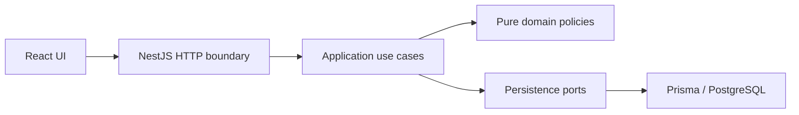

# 1. Title and one-liner

**KJBN Clinic Appointment Scheduler — Problem 2.** Scheduling for a two-doctor
clinic using React, NestJS, PostgreSQL, and Prisma. The M4 UI supports schedules,
booking/rescheduling, patient history, today’s queue and clinic settings through
the verified M3 JSON API.

## 2. Live links

| Resource | Link |
| --- | --- |
| Live UI | [Open application](http://35.244.38.53/) |
| Live API | [Open API](http://35.244.38.53:3000/) |
| API documentation | [Swagger UI](http://35.244.38.53:3000/docs/) |

## 3. Tech stack

TypeScript, React 19/Vite, NestJS 11, Prisma ORM 7, PostgreSQL, npm lockfiles.
Use Node.js 24 LTS and npm. PostgreSQL stores instants with timezone and local
calendar concepts separately. Deployment uses a Linux VM, Docker Compose and
Docker Hub images. The prepared free Render Blueprint remains an alternative.

## 4. Architecture



M3 implements HTTP → validated DTO → application use case → pure policy/port →
Prisma/PostgreSQL. `common/http/` owns request correlation, clock snapshots,
validation, safe errors, structured logging and OpenAPI setup. Controllers map
explicit response DTOs and contain no Prisma queries or scheduling rules.

`appointments/application/` owns booking, cancellation, final status, rescheduling,
free slots and appointment-day reads. `availability/` owns schedule edits/reads;
`doctors/` owns directory/settings operations; `patients/` owns patient directory,
phone lookup and explained history. Feature-owned ports isolate persistence.
Shared clock/locking/error helpers exist only for real cross-feature needs.
All scheduling/directory writes share the PostgreSQL transaction lock; paged query
adapters use coherent snapshots. Prisma retains connection lifecycle. Configuration
is validated once; domain code has no HTTP, NestJS, Prisma or env dependency.
See [M2 design](docs/m2-verification.md) and [M3 verification](docs/m3-verification.md).

The React UI separates feature views (`schedule`, `patients`, `clinic`) from its
explicit API client/response decoders and shared async-state/IST/dialog components.
It uses API-returned slots, derived deposit eligibility and actual mutation results;
failed writes preserve recoverable form inputs. There is no final-build mock data.
See [M4 verification](docs/m4-verification.md) for the workflow and browser evidence.
The [calendar interaction follow-up](docs/calendar-interactions.md) adds compact
selected-slot booking, Move mode across days/doctors and a drag shortcut with
explicit confirmation. Patient/reason carry forward; deposit controls appear
only when required. Mobile and keyboard users can select destinations directly.
The [dashboard follow-up](docs/dashboard-verification.md) adds the default real-data
appointment list with a right-side date calendar, status/doctor/search filters and
Book appointment modal. Select the patient and doctor, choose visual date/time
chips, then confirm; success opens the booked day. Schedule retains grid/move flows.

## 5. Running locally

Prerequisites: Node.js 24 LTS and npm; Docker Compose v2 for containers/tests.
Native development additionally needs PostgreSQL 17 with `btree_gist`. Container
startup needs no separate host PostgreSQL installation.

### Containers (from the project root)

```sh
npm run dev:seed
# Subsequent startup without seeding:
npm run dev
```

The root command creates `.env` from the fictional local example only if absent,
then builds, migrates and waits for readiness. Configure the existing file for
custom ports/credentials; it is never overwritten. `dev:seed` explicitly ensures
the additive seed. The separate `./scripts/migrate-and-seed.sh` remains available.

The UI runs at http://localhost:8080 and proxies `/api/` to the backend; the backend
is also available at http://localhost:3000. PostgreSQL stays on the private Compose
network and persists in the `postgres-data` volume. Root Compose settings and
`backend/.env` are separate: containers receive settings directly from Compose.
Use URL-safe characters for root `POSTGRES_USER`, `POSTGRES_PASSWORD`, and
`POSTGRES_DB`, since Compose builds the database URL from these values. Changing
credentials on an existing PostgreSQL volume does not change the stored database
role password; keep settings consistent or manage that password explicitly.

The normal stack has three services and images: the frontend
(`dharaneesh2574/kjbn-frontend:latest`), backend
(`dharaneesh2574/kjbn-backend:latest`) and PostgreSQL (`postgres:17-alpine`).
`IMAGE_TAG` changes the two application tags. The backend image contains the API,
Prisma migration/seed scripts and their dependencies; the verification suites use
this same image. API and frontend processes run without root. Backend startup
waits for healthy PostgreSQL and applies committed migrations before serving;
frontend startup waits for database-backed API readiness. Seeding is explicit:
`dev:seed` runs `prisma:seed` inside the backend, while `SEED_DEMO_DATA=true`
enables the additive seed on backend startup.

`docker compose down` stops the stack and keeps the database volume. Rebuild after
code changes with `docker compose up --build -d`. Do not delete volumes to perform
routine upgrades. Example-only verification may use `--env-file .env.example`;
normal development uses the private `.env` you created.

### Native development

```sh
cd backend
cp .env.example .env
# Replace DATABASE_URL with your PostgreSQL credentials.
npm ci
npm run prisma:deploy
npm run prisma:seed
npm run build
npm run start:dev
```

In another terminal:

```sh
cd frontend
cp .env.example .env
npm ci
npm run dev
```

Backend variables: `DATABASE_URL` (required PostgreSQL URL), `PORT` (default 3000),
`NODE_ENV` (development/test/production), `CORS_ORIGINS` (comma-separated explicit
HTTP(S) origins), `REVIEW_MODE` (true/false, default false). Clinic timezone is
Asia/Kolkata. Frontend `VITE_API_BASE_URL` is public build-time configuration;
containers use `/api` through nginx, and Vite also proxies `/api` to local port
3000 when no origin is set. Never put secrets in Vite variables. Process
variables take precedence over `.env`; invalid configuration prevents startup
without logging credentials. Run backend commands from `backend/`.

`prisma:deploy` applies versioned SQL migrations; `prisma:seed` explicitly
inserts the fictional catalog without deleting or overwriting existing records.
See [domain-model notes](docs/domain-model.md) for entities and seed cases.
For local database tests, set `TEST_DATABASE_URL` to an isolated database whose
name starts with `kjbn_test_`, then run `npm run test:integration` in `backend/`.
The suite applies migrations and removes only its own test fixtures.

## 5a. Deployment

The user-selected VM is deployed at [35.244.38.53](http://35.244.38.53/) using
[registry-only Compose](deploy/vm/docker-compose.yml). Configuration and all
application persistent volumes live under `~/kjbn` on the VM; PostgreSQL uses
`./data/postgres`. [VM deployment evidence](docs/vm-deployment.md) records pinned
image digests, private environment setup, seed, checks and redeploy commands.
The existing [Render configuration](render.yaml) and [runbook](docs/deployment.md)
remain an alternative; no Render service was created. Full hosted edge-case and
final release verification remain separate gates.

`npm run dev:seed` provides one-command local startup. Hosted startup applies
committed Prisma migrations, explicitly ensures the fictional seed when
`SEED_DEMO_DATA=true`, and stops on any failed step before serving. It never uses
`db push` or resets the database. Normal Docker startup migrates without seeding;
`./scripts/migrate-and-seed.sh` runs the backend's `npm run db:prepare` against
its configured database using the same backend image. From an already running
stack, `docker compose exec backend npm run db:prepare` applies migrations and
ensures the seed. Native development can run `npm run db:prepare` from `backend/`.
Re-seeding preserves catalog edits/history. PostgreSQL must support `btree_gist`.

`/health/live` checks the process; `/health/ready` performs a bounded read of the
migrated schema and returns safe 503 `DATABASE_UNAVAILABLE` on failure. Compose and
Render use readiness. CI runs the same full local coverage gate on isolated
PostgreSQL with no hosted secrets. See [M5 evidence](docs/m5-verification.md).
Render terms checked 2026-10-20: free API sleeps after 15 idle minutes (resume can
take about a minute); free PostgreSQL expires after 30 days with no backups.
Confirm expiry covers review before deployment. These are provider terms, not
measured application cold-start results. [Official limits](https://render.com/docs/free).

The AMD64 app images are published to Docker Hub as
`dharaneesh2574/kjbn-backend:vm-20261022-swagger` and
`dharaneesh2574/kjbn-frontend:vm-20261022-c199607`. The VM pins their digests;
base PostgreSQL/nginx images remain upstream images.
Do not use the local example credentials for a hosted deployment.

## 6. Running tests and coverage

After frontend installation and Chromium setup below, run from the root:

```sh
npm test
npm run coverage
```

Optional manual command `npm run docs:check` verifies required documentation structure, word
limits, local links, milestone hashes, rubric and prompt order. The
[reviewer checklist](docs/reviewer-checklist.md) lists pending hosted checks.

These commands build/lint and run every required backend, real-PostgreSQL,
operational readiness and browser suite against explicitly disposable projects.
`coverage` retains `backend/coverage/all/` and enforces the combined thresholds.
No native PostgreSQL or public hosted service is needed. The CI workflow executes
this same command, without documentation checks. See [deployment runbook](docs/deployment.md).

Individual backend commands (from `backend/`):

```sh
npm run build
npx tsc --noEmit --incremental false
npx eslint src test prisma.config.ts prisma/seed.ts
npm test -- --runInBand
npm run test:rules
npm run test:e2e -- --runInBand
# Set TEST_DATABASE_URL to an isolated PostgreSQL database named kjbn_test_*:
npm run test:all
npm run test:cov:all
```

`test:all` runs all current backend suites: **113 unit/acceptance + 4 HTTP smoke/health + 103
real-PostgreSQL tests**, including **71 API workflow/validation/error/clock/logging/
OpenAPI cases** and 32 schema/seed/concurrency database tests. `test:rules` runs the 74 R1–R7
acceptance cases. The real API suite uses the production HTTP setup and actual
Prisma transactions; it does not replace the rule/DB gate with mocks. No suite
uses a public hosted service.

One full backend gate from the root without native PostgreSQL:

```sh
docker compose -f docker-compose.verify.yml run --build --rm tests npm run test:all
```

One combined coverage run (prints the report; container-local generated files are
removed with the disposable runner):

```sh
docker compose -f docker-compose.verify.yml run --build --rm tests npm run test:cov:all
```

To retain generated reports locally, create `backend/coverage/` first, then add
`-v "$PWD/backend/coverage:/app/coverage"` before `tests` in that command.
The Docker suite uses `kjbn_test_verify` on tmpfs, separate from the application's named
volume. Migrations replay on a fresh test database; fixture cleanup and repeat-seed
checks touch only the isolated database. Stop it afterward with
`docker compose -f docker-compose.verify.yml down --volumes`.

Combined coverage is **97.47% overall backend lines** and **97.91% business-code
lines**, including API and real-DB execution. Scope is `backend/src/**/*.ts`;
tests, Prisma seed/config and orchestration scripts are outside that runtime-source
denominator. Generated Prisma source alone is excluded within `src/`; bootstrap,
module wiring, DTOs, HTTP infrastructure and adapters remain
in the overall denominator. The combined command enforces 80% global metrics plus
specific business-module thresholds. See [coverage.txt](coverage.txt) for all four
metrics and scope, and [M5 evidence](docs/m5-verification.md).

The historical M3 database-free unit/acceptance measurement was 113 tests,
39.34% overall lines and 97.21% business-code lines (before health code). This narrower view
does not instrument API/DB suites and is not the combined overall result. Reports
are ignored under `coverage/`; the sanitized root summary is reviewable.
Frontend verification (from `frontend/`, with Docker Compose v2):

```sh
npm run lint
npm run build
npx playwright install chromium
npm run test:e2e
```

The frontend build checks strict application and test TypeScript. The **27-case
Playwright gate** creates an isolated PostgreSQL/API stack, applies migrations,
uses real HTTP fixtures and runs the UI at 127.0.0.1:4173 against test API port
3011, then tears down only that test stack. These ports must be free. An existing
Chrome binary can be selected with `PLAYWRIGHT_CHROMIUM_EXECUTABLE_PATH`; otherwise
install Chromium with the command above. Reports/traces/screenshots are ignored.
M4 passed 214 backend cases and 27 browser cases; M5 adds four health/API cases
and two seed-preservation regressions. The root gate now combines these suites and operational checks.
See [M4 evidence](docs/m4-verification.md).

## 7. API overview

Local [Swagger UI](http://localhost:3000/docs) and
[OpenAPI JSON](http://localhost:3000/docs-json) describe request/response schemas,
enums, nested windows, pagination, reviewer header and errors. Paths are relative
to the backend root; nginx proxies `/api/` to that root.

| Method | Path | Purpose | Main errors |
| --- | --- | --- | --- |
| GET | `/health/live` | Process liveness | — |
| GET | `/health/ready` | Database and migrated-schema readiness | 503 |
| GET | `/doctors` | Paged list; optional `active` filter | 400 |
| POST | `/doctors` | Create doctor | 400, 409 |
| GET / PUT | `/doctors/:id` | Read / replace settings (PUT 204) | 400, 404, 409 |
| GET | `/doctors/:doctorId/availability` | Weekly hours + overrides in `from`/`to` range | 400, 404, 409 |
| PUT | `/doctors/:doctorId/availability/weekly/:weekday` | Replace ISO weekday windows (204) | 400, 404, 409 |
| PUT / DELETE | `/doctors/:doctorId/availability/overrides/:date` | Replace whole date / restore weekly hours (204) | 400, 404, 409 |
| GET | `/doctors/:doctorId/slots?date=YYYY-MM-DD` | Advisory free UTC intervals | 400, 404, 409 |
| POST | `/patients` | Create normalized-phone patient | 400, 409 |
| GET | `/patients/lookup?phone=...` | Exact normalized phone lookup; encode `+` as `%2B` | 400, 404 |
| GET / PUT | `/patients/:id` | Read / replace patient fields | 400, 404, 409 |
| GET | `/patients/:id/history` | Paged history/events + explained deposit eligibility | 400, 404 |
| GET | `/appointments` | IST day list; defaults to today; optional doctor/patient/status filters | 400 |
| POST | `/appointments` | Book one slot (201); end is server-derived | 400, 404, 409 |
| GET | `/appointments/:id` | Appointment and status events | 400, 404 |
| POST | `/appointments/:id/cancellation` | Cancel (200); empty/no body; idempotent | 400, 404, 409 |
| POST | `/appointments/:id/reschedules` | Atomic cancel + linked replacement (201) | 400, 404, 409 |
| PATCH | `/appointments/:id/status` | `COMPLETED` or `NO_SHOW` after end (200) | 400, 404, 409 |

All controller routes can also return 403 for a disabled reviewer override or a
safe 500 for unexpected failure. Collection pages use `{items,total,offset,limit}`:
default limit 20, maximum 100, offset 0–1,000,000. Doctors sort by name/ID;
appointments by UTC start/ID; patient history by descending start then ID.
`GET /appointments?status=BOOKED` provides today's queue; add a date for another
IST day. Valid filters with no matches return an empty page. Addressed missing
resources return 404. Override deletion is idempotent when the doctor exists.

Bodies reject unknown fields, including client `endsAt`, derived flags and
arbitrary appointment statuses. JSON numbers/booleans must have the right types.
The scaffold `GET /` is retained for compatibility/container liveness; it is not
DB readiness. Explicit response DTOs exclude Prisma metadata and timestamps such
as internal `createdAt`/`updatedAt`.

## 8. Business rules and assumptions

| Rule | M2 policy exposed through the M3 API | Tests |
| --- | --- | --- |
| R1 | Effective windows, complete override replacement, slot grid, protected edits | R1 acceptance + DB booking/edit races |
| R2 | Half-open doctor overlap check and GiST constraint | R2 acceptance + concurrent use-case bookings |
| R3 | Patient overlap across doctors | R3 acceptance + concurrent patient bookings/reschedules |
| R4 | Atomic IST doctor-day cap; both cancellation statuses excluded | R4 acceptance + final-capacity/cap-edit races |
| R5 | Cancellation boundary, lifecycle, derived penalties and deposit acknowledgement | R5 acceptance + status/history/penalty persistence |
| R6 | Atomic linked cancel + book; rollback preserves original/history | R6 acceptance + failure-after-insert and concurrent reschedules |
| R7 | One injected time value, past and inclusive elapsed 60-day horizon | R7 acceptance + timezone/calendar boundaries |

Tests: `backend/test/rules.acceptance.spec.ts` and
`backend/test/scheduling.integration-spec.ts`; M1 schema evidence remains in
`backend/test/domain.integration-spec.ts`. M3 HTTP evidence is in
`backend/test/api.integration-spec.ts`; see [M2](docs/m2-verification.md) and
[M3 verification](docs/m3-verification.md). M4 UI evidence is in
`frontend/e2e/clinic.spec.ts` and [M4 verification](docs/m4-verification.md).

The following are documented project assumptions, not extra source requirements:

1. **Intervals and slots:** half-open `[start, end)` permits adjacency. One booking
   lasts exactly the doctor's 15/30-minute slot, snapshotted on the appointment.
   The grid starts at each effective availability window's opening minute.
2. **Participation:** Booked, Completed, and No-Show block overlap and count toward
   the doctor's day cap. Cancelled and Late-Cancelled do neither. Retain every row.
3. **Transitions:** only Booked transitions to Completed, No-Show, Cancelled, or
   Late-Cancelled. Completion/no-show require `now >= end`. Repeated cancellation
   is idempotent without changing its original time. Final states are immutable.
   Rescheduling is allowed only from Booked and retains cancellation penalties.
4. **Penalties:** late cancellation occurs at `cancelledAt`; no-show is attributed
   to appointment start. Count events in `(now - 30 elapsed days, now]`. At least
   two require deposit acknowledgement, recorded at booking time; no money is
   processed. Derive deposit-required from history, never from a persistent flag.
5. **Time:** exact-now is bookable; elapsed `now + 60 * 24h` is the inclusive last
   instant. Derive doctor-days and weekday in Asia/Kolkata; store instants in UTC.
6. **Availability:** ISO weekdays 1–7; local minutes 0–1440; no overnight windows
   (split at midnight). Date overrides replace the entire weekly day; zero windows
   means leave, and windows on a normally closed day mean extra availability.
   Windows on the same day cannot overlap; adjacency is allowed.
7. **Patients:** require international E.164 phone numbers with explicit `+` and
   country code; strip spaces, parentheses, periods, and hyphens before uniqueness
   checks. No country is guessed. DOB is a real local date, at most the request's IST date.
   Assistance flags describe needs; deposit-required is separate derived information.
8. **Edits:** reject availability/doctor-setting edits that would invalidate
   existing occupied appointments, report conflicts, and require resolution. Do
   not rewrite historical slot durations or silently cancel bookings.
9. **Reviewer clock:** `REVIEW_MODE` defaults false. M3 accepts `X-Review-Now`
   only when that trusted configuration is true (otherwise 403); malformed or
   offset-free timestamps return 400. Middleware captures arrival once and the
   request-scoped clock freezes one value shared by every guard/use case. Parallel
   overrides are isolated; logs use actual UTC time. Global/system time is unchanged.
10. **History:** restrict parent deletion, append status events, and link each
    replacement appointment to its cancelled original with at most one successor.
    M2 updates status/history/reschedule rows and checks capacity in one transaction.
11. **Seed:** stable fictional data uses reference `2026-10-19T03:00:00Z` (08:30 IST).
    Re-seeding inserts missing catalog rows and preserves existing data/edits;
    availability is bootstrapped only when a seed doctor is first created. Existing
    weekly hours, closed weekdays, leave windows and removed overrides are retained,
    even when replacement row IDs differ. It never truncates tables. Use a fresh
    database for the exact initial fixture.

12. **Concurrency:** one transaction-scoped PostgreSQL advisory lock serializes all
    scheduling writers, including availability/settings edits and explicit seed
    imports. Lock wait is bounded at 5 seconds; application transactions at 15
    seconds. Busy transactions return `CONCURRENT_MODIFICATION` without hidden
    retries. Free slots are coherent advisory snapshots and are rechecked on booking.
13. **Setting/history protection:** edits validate every occupied row, including
    history, against the resulting availability, grid and cap. Slot-duration
    snapshots are preserved when settings change; new bookings use the new length.
    Deactivation rejects while any Booked rows remain. Use future date overrides
    when a weekly change would invalidate immutable history. UUIDs are canonical
    lowercase; positive caps must fit PostgreSQL's signed integer representation.
14. **API bounds:** default page 0/20, maximum limit 100 and offset 1,000,000.
    Availability range defaults to today through day +60 with at most 366 elapsed
    days between inclusive endpoints; at most 32 submitted windows per day. PUT
    replaces complete doctor/patient settings; no destructive history deletion.
15. **DOB and review time:** application validation uses the request snapshot.
    PostgreSQL keeps structural DOB date bounds; the M3 migration replaces M1's
    database-wall-clock future check so it cannot contradict reviewer time.
16. **UI snapshots:** the day grid combines API-returned slots and occupied
    appointments; cancelled rows remain separately visible. Refresh on writes and
    explicit request; the backend rechecks all rules. UI dates are always IST,
    reviewer settings/data stay in memory, and writes have no automatic retry.

## 9. Error handling and logging

All HTTP failures use a stable envelope:

```json
{"code":"DOCTOR_OVERLAP","message":"Doctor already has an overlapping appointment","requestId":"00000000-0000-4000-8000-000000000001"}
```

DTO/unknown-field errors are 400 `VALIDATION_FAILED`; domain values are 400
`INVALID_DOMAIN_VALUE`; missing resources are 404 `NOT_FOUND`; disabled reviewer
overrides are 403 `CLOCK_OVERRIDE_DISABLED`; business, duplicate-phone and bounded
contention conflicts are 409. Occupied schedule edits include
`details.appointmentIds`. Malformed requests use 400 `BAD_REQUEST`; framework
body-size rejection uses 413 `PAYLOAD_TOO_LARGE`. Unexpected/database failures use
500 `INTERNAL_ERROR` with a fixed safe message. Known constraints/timeouts alone
are translated; failures retain transaction rollback semantics. DTO errors never
echo submitted values; raw database metadata/stacks are not client responses.

Every response has a server-generated `X-Request-Id`; errors repeat it in the body.
One JSON log per completed request includes real UTC timestamp, level, request ID,
route-template operation, HTTP status, duration, safe failure code and validated
UUID resource IDs. Rule/input failures use warn; unexpected failures use error.
The filter does not duplicate the request error log. Bodies, query strings, raw
URLs, names, phones, DOBs, exception text, credentials and connection strings are
excluded. Logs do not use reviewer time. Startup emits sanitized structured status.
View local logs with `docker compose logs -f backend`; hosted backend logs will be
in Render’s service Logs view after deployment. Readiness failures return safe
503 `DATABASE_UNAVAILABLE` and use the same correlated completion log.
Responses use `Cache-Control: no-store`; CORS uses explicit configured origins.

## 10. Reviewer aids

In the UI, use **Schedule** for per-doctor slots, **Patients** for phone/history,
**Today’s queue** for lifecycle updates, and **Clinic settings** for doctors/hours.
Select a free slot or Book appointment, find/register a patient, enter a reason,
and acknowledge the deposit when required. Open a booked slot to cancel or
reschedule; invalid replacements retain the original. All displayed times are IST.

The footer’s **Reviewer clock** panel sends an explicit-offset timestamp on every
API request and reloads clock-dependent UI state. **Use real time** clears it.
Normal mode rejects `X-Review-Now` with 403. Enable review mode explicitly:

```sh
# Native backend (from backend/):
REVIEW_MODE=true npm run start:dev
# Or root Compose; this changes configuration on the recreated backend:
REVIEW_MODE=true docker compose up --build -d backend
```

Set `REVIEW_MODE=false` and recreate/restart afterward for normal time. One request
uses its own immutable snapshot. Missing timezone offsets or invalid dates return
400. Never modify the host clock.

Seed reference: **2026-10-19 08:30 IST** (`2026-10-19T03:00:00Z`). Explicitly run
`npm run prisma:seed` or the documented root seed helper when needed; imports
preserve existing edits or roll back on conflict. Normal local startup only migrates;
the hosted demo launcher seeds only when explicitly configured with `SEED_DEMO_DATA=true`.
Phone `+12025550103` has two recent penalties; `+12025550102` has one. A fresh
isolated database gives the exact initial catalog; see [domain notes](docs/domain-model.md).

```sh
curl -G 'http://localhost:3000/patients/lookup' --data-urlencode 'phone=+12025550103'
curl -H 'X-Review-Now: 2026-10-19T08:30:00+05:30' \
  'http://localhost:3000/patients/10000000-0000-4000-8000-000000000013/history?limit=1'
curl -H 'X-Review-Now: 2026-11-19T08:30:00+05:30' \
  'http://localhost:3000/patients/10000000-0000-4000-8000-000000000013/history?limit=1'
```

History explains the derived deposit flag independently of pagination; later time
expires penalties automatically. To book that flagged fictional patient, send
`depositAcknowledged:true`; false is rejected with `DEPOSIT_REQUIRED`. This is an
acknowledgement, not payment processing. Free slots are advisory and rechecked.

For a Booked **09:30 IST** appointment, cancellation at **07:30** is Cancelled,
**07:31** is Late-Cancelled, and **07:29** is Cancelled. Send the corresponding
explicit-offset header to `POST /appointments/:id/cancellation` with no body.
Use separate Booked appointments for each boundary; repeated cancellation preserves
its original classification/time. Failed rescheduling leaves the original row and
history untouched. `/docs` provides executable request schemas for all operations.

## 11. Known limitations

M4 is verified locally in Chrome, including phone widths; other browser/device
coverage and a full accessibility audit remain unverified. The VM UI/API and
fresh seeded database are live; the complete hosted edge-case matrix, current
remote CI result, clean-clone final verification and submission tagging remain
M5/M6 release checks. Authentication
is optional and not implemented. No stretch features have started.

The clinic-wide write lock favors understandable correctness over throughput.
Schedule edits conservatively protect historical occupied rows; use future date
overrides when weekly edits would invalidate immutable history. The retained `/`
smoke route is liveness only. Review-mode time is intentional request-local testing;
normal-mode DOB/horizon decisions use real request arrival time. Status and evidence
are recorded in `AGENTS.md`, `SUBMISSION.md`, and the milestone verification notes.
The M5 implementation and M4 follow-ups are in `eff65d8`; the VM uses application
source at `c199607`. [VM evidence](docs/vm-deployment.md) records this deployment;
full M5/M6 release gates remain pending. [M6 evidence](docs/m6-verification.md) records the historical failed
committed clean clone, candidate packaging checks and targeted repository audit.
The final `v1.0` tag must identify the verified user-created final commit.

Both application npm lockfiles and verification Compose are tracked at the current
local deployment source `c199607`. `npm ci`, Docker, CI and hosting builds require them. The
two Actions runs through `0bd2f22` failed before tests at dependency-cache setup
because the frontend lockfile was missing. A fresh clone of historical `eff65d8`
fails npm ci and lacks `docker-compose.verify.yml`; no published clean-clone pass is claimed.
Candidate checks that temporarily include lockfiles are explicitly distinguished
from committed-clone evidence. The Git index is unchanged.

## 12. AI and third-party usage

OpenAI Codex assisted with scaffolding, configuration, domain modeling, business
policies, API/UI implementation/tests, documentation, local containers and M5
health/CI/hosting preparation, plus M6 documentation/checking. The user reviews
and commits changes; AI assistance does not establish hosted/release completion.
M5 primary references are in the deployment runbook. React/Vite
and NestJS scaffolds remain; M4 replaces the visible frontend starter. M3 adds compatible Nest Swagger 11,
class-validator and class-transformer; versions are governed by manifests/lockfiles.
Official Nest documentation informed validation, request scopes and OpenAPI setup;
references and design costs are in [M3 evidence](docs/m3-verification.md).
M4 adds Playwright with real-API browser fixtures; the UI uses native controls and
CSS/SVG and MIT Phosphor icons for the dashboard. No source photos/branding or
image-generated production assets are embedded. Official React/Playwright references are in [M4 evidence](docs/m4-verification.md).
See [PROMPTS.md](PROMPTS.md) for chronological requests and use notes.

Dashboard visual references: [Nasim’s Doctor Appointment Booking](https://dribbble.com/shots/27618363-Doctor-Appointment-Booking) and the user-supplied picker image; adapted to the existing clinic theme. New icons use [Phosphor React](https://github.com/phosphor-icons/react), version 2.1.10, MIT. Source photos/branding are not embedded. See [design QA](design-qa.md).
