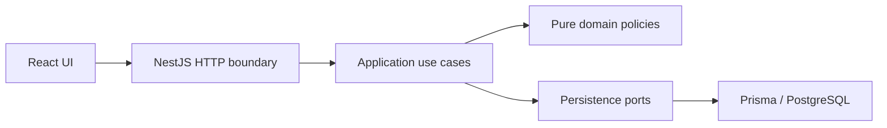

# 1. Title and one-liner

**KJBN Clinic Appointment Scheduler — Problem 2.** Scheduling for a two-doctor
clinic using React, NestJS, PostgreSQL, and Prisma. M0 and M1 establish the data model;
booking workflows are not yet available.

## 2. Live links

No public deployment yet. Local UI: http://localhost:5173. Local backend:
http://localhost:3000. API documentation and cold-start measurements are pending M3/M5.

## 3. Tech stack

TypeScript, React 19/Vite, NestJS 11, Prisma ORM 7, PostgreSQL, npm lockfiles.
Use Node.js 24 LTS and npm. PostgreSQL stores instants with timezone and local
calendar concepts separately. Hosting has not been selected.

## 4. Architecture



The diagram is the target architecture; use cases/API are pending M2/M3.
`frontend/` and `backend/` share one root Git repository and `.gitignore`.
`backend/src/common/config/` initializes a validated, injected `AppConfig` from
process variables and `backend/.env`. Prisma owns connection lifecycle. Domain
code must not read environment variables or import NestJS/Prisma.

## 5. Running locally

Prerequisites: Node.js 24 LTS, npm, PostgreSQL, and (for containers) Docker Compose v2.

```sh
cd backend
cp .env.example .env
# Replace DATABASE_URL with your PostgreSQL credentials.
npm ci
npm run prisma:deploy
npm run prisma:seed
npm run build
npm run start:dev
```

In another terminal:

```sh
cd frontend
cp .env.example .env
npm ci
npm run dev
```

Backend variables: `DATABASE_URL` (required PostgreSQL URL), `PORT` (default 3000),
`NODE_ENV` (development/test/production), `CORS_ORIGINS` (comma-separated explicit
HTTP(S) origins), `REVIEW_MODE` (true/false, default false). Clinic timezone is
Asia/Kolkata. Frontend `VITE_API_BASE_URL` is public build-time configuration;
UI integration is pending M4. Never put secrets in Vite variables. Process
variables take precedence over `.env`; invalid configuration prevents startup
without logging credentials. Run backend commands from `backend/`.

`prisma:deploy` applies the committed SQL migration; `prisma:seed` explicitly
inserts the fictional catalog without deleting or overwriting existing records.
See [domain-model notes](docs/domain-model.md) for entities and seed cases.
For local database tests, set `TEST_DATABASE_URL` to an isolated database whose
name starts with `kjbn_test_`, then run `npm run test:integration` in `backend/`.
The suite applies migrations and removes only its own test fixtures.

## 5a. Deployment

No hosting provider or public deployment yet. Do not treat local containers as a
verified hosted deployment. Prisma generation runs after install and before
build; development dependencies must be installed in the build/migration stage.

## 6. Running tests and coverage

```sh
cd backend
npm run build
npm test -- --runInBand
npm run test:e2e -- --runInBand
npm run test:cov -- --runInBand
```

Read-only lint: `npx eslint src test prisma.config.ts`. Frontend checks:
`npm run lint` and `npm run build` from `frontend/`. Existing HTTP tests mock the
database provider; they do not verify real database behavior. `npm run test:integration` runs real PostgreSQL migration/constraint/concurrent
insert/seed tests (requires isolated `TEST_DATABASE_URL`). `npm run test:rules`
reports 35 explicit M2 TODO cases. These TODOs are not passing business-rule tests.
Unit coverage is 78.26% of handwritten backend lines; generated Prisma files
are excluded, while bootstrap/module wiring remains in the denominator. See
`coverage.txt`. Final business-rule coverage and an all-required-suite gate remain
pending M2.

## 7. API overview

| Method | Path | Purpose | Main errors |
| --- | --- | --- | --- |
| GET | / | Scaffold greeting | Generic NestJS errors |

Doctor/availability/patient/appointment routes and OpenAPI are pending M3.

## 8. Business rules and assumptions

| Rule | M1 evidence | Remaining M2 work |
| --- | --- | --- |
| R1 | Window bounds/overlap checks and override/leave fixtures | Effective availability, grid, edit protection |
| R2 | Doctor exclusion constraint; concurrent insert test | Deliberate application conflict handling |
| R3 | Patient exclusion constraint; concurrent cross-doctor insert test | Application workflow checks |
| R4 | Positive daily-cap field/check | Atomic doctor-day capacity enforcement |
| R5 | Cancellation timestamp check, status history, penalty fixtures | Eligibility, lookback, acknowledgement and lifecycle policies |
| R6 | Predecessor relation and database rollback test | Protected cancel-and-book use case |
| R7 | Offset/date value validation | Injected-clock past/60-day checks |

Integration evidence: `backend/test/domain.integration-spec.ts`. Pending behavioral
cases: `backend/test/rules.acceptance.spec.ts`.
Behavioral use cases remain M2. M1 decisions (project assumptions, not claims
about unspecified source requirements):

1. **Intervals and slots:** half-open `[start, end)` permits adjacency. One booking
   lasts exactly the doctor's 15/30-minute slot, snapshotted on the appointment.
   The grid starts at each effective availability window's opening minute.
2. **Participation:** Booked, Completed, and No-Show block overlap and count toward
   the doctor's day cap. Cancelled and Late-Cancelled do neither. Retain every row.
3. **Transitions:** only Booked transitions to Completed, No-Show, Cancelled, or
   Late-Cancelled. Completion/no-show require `now >= end`. Repeated cancellation
   is idempotent without changing its original time. Final states are immutable.
   Rescheduling is allowed only from Booked and retains cancellation penalties.
4. **Penalties:** late cancellation occurs at `cancelledAt`; no-show is attributed
   to appointment start. Count events in `(now - 30 elapsed days, now]`. At least
   two require deposit acknowledgement, recorded at booking time; no money is
   processed. Derive deposit-required from history, never from a persistent flag.
5. **Time:** exact-now is bookable; elapsed `now + 60 * 24h` is the inclusive last
   instant. Derive doctor-days and weekday in Asia/Kolkata; store instants in UTC.
6. **Availability:** ISO weekdays 1–7; local minutes 0–1440; no overnight windows
   (split at midnight). Date overrides replace the entire weekly day; zero windows
   means leave, and windows on a normally closed day mean extra availability.
   Windows on the same day cannot overlap; adjacency is allowed.
7. **Patients:** require international E.164 phone numbers with explicit `+` and
   country code; strip spaces, parentheses, periods, and hyphens before uniqueness
   checks. No country is guessed. DOB is a real local date, at most today's IST date.
   Assistance flags describe needs; deposit-required is separate derived information.
8. **Edits:** reject availability/doctor-setting edits that would invalidate
   existing occupied appointments, report conflicts, and require resolution. Do
   not rewrite historical slot durations or silently cancel bookings.
9. **Reviewer clock:** `REVIEW_MODE` defaults false. M3 must validate an explicit
   offset timestamp and provide one immutable clock snapshot per request; it must
   never change global/system time. This request override is not implemented yet.
10. **History:** restrict parent deletion, append status events, and link each
    replacement appointment to its cancelled original with at most one successor.
    M2 must update status, history, cap, and reschedule rows in one transaction.
11. **Seed:** stable fictional data uses reference `2026-10-19T03:00:00Z` (08:30 IST).
    Re-seeding inserts missing catalog rows and preserves existing data/edits;
    it never truncates tables. Use a fresh database for the exact initial fixture.

M1's executable entity tests and real-database constraint tests cover structural
invariants. `backend/test/rules.acceptance.spec.ts` records R1–R7 acceptance cases
as explicit TODO tests; they are not evidence that the M2 rules already pass.

## 9. Error handling and logging

Environment validation rejects malformed values with credential-free messages.
Business error envelopes, stable rule codes, and structured request logging are
pending M3. Current HTTP behavior is NestJS scaffold behavior.

## 10. Reviewer aids

`REVIEW_MODE` is validated configuration only; no request clock override endpoint
or header is implemented yet. Never modify the host clock. For seeded history use reference `2026-10-19T03:00:00Z` (08:30 IST); see
`docs/domain-model.md`. Phone `+12025550103` has two recent penalties and an
acknowledged upcoming booking. `+12025550102` has one penalty. Re-run
`npm run prisma:seed` explicitly to ensure missing catalog records; existing edits
are preserved. A fresh database gives the exact initial catalog.

## 11. Known limitations

No booking API, business use cases, integrated scheduling UI, public deployment,
CI, or hosted verification yet. Status is tracked in `AGENTS.md` and `SUBMISSION.md`.
No final coverage or concurrency-safety claim is made by the scaffold.

## 12. AI and third-party usage

OpenAI Codex assisted with scaffolding, configuration, domain modeling, tests,
and container setup. React/Vite and NestJS starter templates were retained.
See [PROMPTS.md](PROMPTS.md) for requests and use notes.
