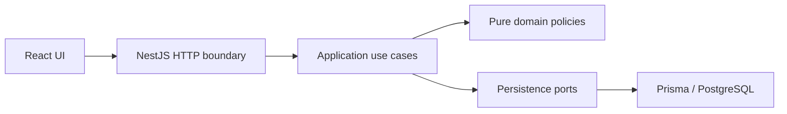

# 1. Title and one-liner

**KJBN Clinic Appointment Scheduler — Problem 2.** Scheduling for a two-doctor
clinic using React, NestJS, PostgreSQL, and Prisma. Implementation is at M0/M1;
booking workflows are not yet available.

## 2. Live links

No public deployment yet. Local UI: http://localhost:5173. Local backend:
http://localhost:3000. API documentation and cold-start measurements are pending M3/M5.

## 3. Tech stack

TypeScript, React 19/Vite, NestJS 11, Prisma ORM 7, PostgreSQL, npm lockfiles.
Use Node.js 24 LTS and npm. PostgreSQL stores instants with timezone and local
calendar concepts separately. Hosting has not been selected.

## 4. Architecture



The diagram is the target architecture; use cases/API are pending M2/M3.
`frontend/` and `backend/` share one root Git repository and `.gitignore`.
`backend/src/common/config/` initializes a validated, injected `AppConfig` from
process variables and `backend/.env`. Prisma owns connection lifecycle. Domain
code must not read environment variables or import NestJS/Prisma.

## 5. Running locally

Prerequisites: Node.js 24 LTS, npm, PostgreSQL, and (for containers) Docker Compose v2.

```sh
cd backend
cp .env.example .env
# Replace DATABASE_URL with your PostgreSQL credentials.
npm ci
npm run build
npm run start:dev
```

In another terminal:

```sh
cd frontend
cp .env.example .env
npm ci
npm run dev
```

Backend variables: `DATABASE_URL` (required PostgreSQL URL), `PORT` (default 3000),
`NODE_ENV` (development/test/production), `CORS_ORIGINS` (comma-separated explicit
HTTP(S) origins), `REVIEW_MODE` (true/false, default false). Clinic timezone is
Asia/Kolkata. Frontend `VITE_API_BASE_URL` is public build-time configuration;
UI integration is pending M4. Never put secrets in Vite variables. Process
variables take precedence over `.env`; invalid configuration prevents startup
without logging credentials. Run backend commands from `backend/`.

Migrations, seed, and the one-command container stack are being added in M1 and
the user-requested early container setup. See subsequent milestone evidence.

## 5a. Deployment

No hosting provider or public deployment yet. Do not treat local containers as a
verified hosted deployment. Prisma generation runs after install and before
build; development dependencies must be installed in the build/migration stage.

## 6. Running tests and coverage

```sh
cd backend
npm run build
npm test -- --runInBand
npm run test:e2e -- --runInBand
npm run test:cov -- --runInBand
```

Read-only lint: `npx eslint src test prisma.config.ts`. Frontend checks:
`npm run lint` and `npm run build` from `frontend/`. Existing HTTP tests mock the
database provider; they do not verify real database behavior. Business-rule
coverage and an all-suite command are pending their implementations.

## 7. API overview

| Method | Path | Purpose | Main errors |
| --- | --- | --- | --- |
| GET | / | Scaffold greeting | Generic NestJS errors |

Doctor/availability/patient/appointment routes and OpenAPI are pending M3.

## 8. Business rules and assumptions

R1 availability/grid; R2 doctor overlap; R3 patient overlap; R4 daily cap;
R5 cancellation/deposit; R6 atomic rescheduling; R7 booking horizon.
Implementation is pending M2. The M1 domain decisions and test inventory will be
recorded here before domain implementation is relied on.

## 9. Error handling and logging

Environment validation rejects malformed values with credential-free messages.
Business error envelopes, stable rule codes, and structured request logging are
pending M3. Current HTTP behavior is NestJS scaffold behavior.

## 10. Reviewer aids

`REVIEW_MODE` is validated configuration only; no request clock override endpoint
or header is implemented yet. Never modify the host clock. Seed instructions and
fixed reference dates are added with M1.

## 11. Known limitations

No booking API, business use cases, integrated scheduling UI, public deployment,
CI, or hosted verification yet. Status is tracked in `AGENTS.md` and `SUBMISSION.md`.
No final coverage or concurrency-safety claim is made by the scaffold.

## 12. AI and third-party usage

OpenAI Codex assisted with scaffolding, configuration, domain modeling, tests,
and container setup. React/Vite and NestJS starter templates were retained.
See [PROMPTS.md](PROMPTS.md) for requests and use notes.
