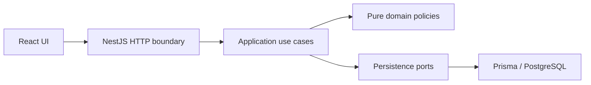

# 1. Title and one-liner

**KJBN Clinic Appointment Scheduler — Problem 2.** Scheduling for a two-doctor
clinic using React, NestJS, PostgreSQL, and Prisma. M3 exposes the verified rules
through a validated, documented JSON API;
the integrated scheduling UI remains M4.

## 2. Live links

No public deployment yet. Local container UI: http://localhost:8080; Vite UI:
http://localhost:5173; API: http://localhost:3000;
[Swagger UI](http://localhost:3000/docs) and [OpenAPI JSON](http://localhost:3000/docs-json).
The UI is still the starter; API integration is M4. Rebuild/restart the backend after
source changes. Hosted URLs and cold-start measurements remain M5.

## 3. Tech stack

TypeScript, React 19/Vite, NestJS 11, Prisma ORM 7, PostgreSQL, npm lockfiles.
Use Node.js 24 LTS and npm. PostgreSQL stores instants with timezone and local
calendar concepts separately. Hosting has not been selected.

## 4. Architecture



M3 implements HTTP → validated DTO → application use case → pure policy/port →
Prisma/PostgreSQL. `common/http/` owns request correlation, clock snapshots,
validation, safe errors, structured logging and OpenAPI setup. Controllers map
explicit response DTOs and contain no Prisma queries or scheduling rules.

`appointments/application/` owns booking, cancellation, final status, rescheduling,
free slots and appointment-day reads. `availability/` owns schedule edits/reads;
`doctors/` owns directory/settings operations; `patients/` owns patient directory,
phone lookup and explained history. Feature-owned ports isolate persistence.
Shared clock/locking/error helpers exist only for real cross-feature needs.
All scheduling/directory writes share the PostgreSQL transaction lock; paged query
adapters use coherent snapshots. Prisma retains connection lifecycle. Configuration
is validated once; domain code has no HTTP, NestJS, Prisma or env dependency.
See [M2 design](docs/m2-verification.md) and [M3 verification](docs/m3-verification.md).

## 5. Running locally

Prerequisites: Node.js 24 LTS, npm, PostgreSQL, and (for containers) Docker Compose v2.

### Containers (from the project root)

```sh
cp .env.example .env
# Set your local PostgreSQL password and optional host ports in .env.
docker compose up --build -d
# Seed is explicit; normal startup only migrates.
./scripts/migrate-and-seed.sh
```

The UI runs at http://localhost:8080 and proxies `/api/` to the backend; the backend
is also available at http://localhost:3000. PostgreSQL stays on the private Compose
network and persists in the `postgres-data` volume. Root Compose settings and
`backend/.env` are separate: containers receive settings directly from Compose.
Use URL-safe characters for root `POSTGRES_USER`, `POSTGRES_PASSWORD`, and
`POSTGRES_DB`, since Compose builds the database URL from these values. Changing
credentials on an existing PostgreSQL volume does not change the stored database
role password; keep settings consistent or manage that password explicitly.

Images are tagged `dharaneesh2574/kjbn-frontend:latest`,
`dharaneesh2574/kjbn-backend:latest`, and
`dharaneesh2574/kjbn-backend:latest-tooling`. `IMAGE_TAG` changes their tags. The
tooling image holds the Prisma CLI/seed/tests; the non-root backend runtime holds
only production dependencies and compiled code. Frontend nginx also runs without
root. The migration job waits for healthy PostgreSQL; backend startup waits for
successful migration; frontend startup waits for the backend HTTP check.

`docker compose down` stops the stack and keeps the database volume. Rebuild after
code changes with `docker compose up --build -d`. Do not delete volumes to perform
routine upgrades. Example-only verification may use `--env-file .env.example`;
normal development uses the private `.env` you created.

### Native development

```sh
cd backend
cp .env.example .env
# Replace DATABASE_URL with your PostgreSQL credentials.
npm ci
npm run prisma:deploy
npm run prisma:seed
npm run build
npm run start:dev
```

In another terminal:

```sh
cd frontend
cp .env.example .env
npm ci
npm run dev
```

Backend variables: `DATABASE_URL` (required PostgreSQL URL), `PORT` (default 3000),
`NODE_ENV` (development/test/production), `CORS_ORIGINS` (comma-separated explicit
HTTP(S) origins), `REVIEW_MODE` (true/false, default false). Clinic timezone is
Asia/Kolkata. Frontend `VITE_API_BASE_URL` is public build-time configuration;
UI integration is pending M4; the backend API is implemented in M3. Never put secrets in Vite variables. Process
variables take precedence over `.env`; invalid configuration prevents startup
without logging credentials. Run backend commands from `backend/`.

`prisma:deploy` applies versioned SQL migrations; `prisma:seed` explicitly
inserts the fictional catalog without deleting or overwriting existing records.
See [domain-model notes](docs/domain-model.md) for entities and seed cases.
For local database tests, set `TEST_DATABASE_URL` to an isolated database whose
name starts with `kjbn_test_`, then run `npm run test:integration` in `backend/`.
The suite applies migrations and removes only its own test fixtures.

## 5a. Deployment

No hosting provider or public deployment yet. Local Docker verification is a
subset of M5 explicitly requested early; hosted deployment, dedicated readiness,
and CI remain pending. `docker-compose.yml`, service Dockerfiles, and
`scripts/migrate-and-seed.sh` are the local build/migrate/seed path. Re-seeding is
explicit and preserves catalog edits. Prisma generation runs after install and
before build. OpenSSL and Prisma engine preparation are included in the tooling
image for reliable migration execution. PostgreSQL must support `btree_gist`.

The app images are built/tagged locally, not published to Docker Hub. Publishing
can be performed separately after `docker login` with
`docker compose push frontend backend migrate`; base PostgreSQL/nginx images remain upstream images.
Do not use the local example credentials for a hosted deployment.

## 6. Running tests and coverage

Run from `backend/`:

```sh
npm run build
npx tsc --noEmit --incremental false
npx eslint src test prisma.config.ts prisma/seed.ts
npm test -- --runInBand
npm run test:rules
npm run test:e2e -- --runInBand
# Set TEST_DATABASE_URL to an isolated PostgreSQL database named kjbn_test_*:
npm run test:all
npm run test:cov:all
```

`test:all` runs all current suites: **113 unit/acceptance + 1 HTTP smoke + 100
real-PostgreSQL tests**, including **70 API workflow/validation/error/clock/logging/
OpenAPI cases** and 30 M1/M2 database tests. `test:rules` runs the 74 R1–R7
acceptance cases. The real API suite uses the production HTTP setup and actual
Prisma transactions; it does not replace the rule/DB gate with mocks. No suite
uses a public hosted service.

One full gate from the root without native PostgreSQL:

```sh
docker compose --env-file .env.example --profile test run --build --rm integration npm run test:all
```

One combined coverage run (prints the report; container-local generated files are
removed with the disposable runner):

```sh
docker compose --env-file .env.example --profile test run --build --rm integration npm run test:cov:all
```

To retain generated reports locally, create `backend/coverage/` first, then add
`-v "$PWD/backend/coverage:/app/coverage"` before `integration` in that command.
The Docker suite uses `kjbn_test_m1` on tmpfs, separate from the application's named
volume. Migrations replay on a fresh test database; fixture cleanup and repeat-seed
checks touch only the isolated database. Stop it afterward with
`docker compose --env-file .env.example stop test-db`.

Combined coverage is **97.48% overall backend lines** and **97.91% business-code
lines**, including API and real-DB execution. Generated Prisma source alone is
excluded; bootstrap, module wiring, DTOs, HTTP infrastructure and adapters remain
in the overall denominator. The combined command enforces 80% global metrics plus
specific business-module thresholds. See [coverage.txt](coverage.txt) for all four
metrics and scope, and [M3 evidence](docs/m3-verification.md).

`npm run test:cov -- --runInBand` retains the database-free unit/acceptance view:
113 tests, 39.34% overall lines and 97.21% business-code lines. This narrower view
does not instrument API/DB suites and is not the combined overall result. Reports
are ignored under `coverage/`; the sanitized root summary is reviewable.
Frontend checks remain `npm run lint` and `npm run build` from `frontend/`.

## 7. API overview

Local [Swagger UI](http://localhost:3000/docs) and
[OpenAPI JSON](http://localhost:3000/docs-json) describe request/response schemas,
enums, nested windows, pagination, reviewer header and errors. Paths are relative
to the backend root; nginx proxies `/api/` to that root.

| Method | Path | Purpose | Main errors |
| --- | --- | --- | --- |
| GET | `/doctors` | Paged list; optional `active` filter | 400 |
| POST | `/doctors` | Create doctor | 400, 409 |
| GET / PUT | `/doctors/:id` | Read / replace settings (PUT 204) | 400, 404, 409 |
| GET | `/doctors/:doctorId/availability` | Weekly hours + overrides in `from`/`to` range | 400, 404, 409 |
| PUT | `/doctors/:doctorId/availability/weekly/:weekday` | Replace ISO weekday windows (204) | 400, 404, 409 |
| PUT / DELETE | `/doctors/:doctorId/availability/overrides/:date` | Replace whole date / restore weekly hours (204) | 400, 404, 409 |
| GET | `/doctors/:doctorId/slots?date=YYYY-MM-DD` | Advisory free UTC intervals | 400, 404, 409 |
| POST | `/patients` | Create normalized-phone patient | 400, 409 |
| GET | `/patients/lookup?phone=...` | Exact normalized phone lookup; encode `+` as `%2B` | 400, 404 |
| GET / PUT | `/patients/:id` | Read / replace patient fields | 400, 404, 409 |
| GET | `/patients/:id/history` | Paged history/events + explained deposit eligibility | 400, 404 |
| GET | `/appointments` | IST day list; defaults to today; optional doctor/patient/status filters | 400 |
| POST | `/appointments` | Book one slot (201); end is server-derived | 400, 404, 409 |
| GET | `/appointments/:id` | Appointment and status events | 400, 404 |
| POST | `/appointments/:id/cancellation` | Cancel (200); empty/no body; idempotent | 400, 404, 409 |
| POST | `/appointments/:id/reschedules` | Atomic cancel + linked replacement (201) | 400, 404, 409 |
| PATCH | `/appointments/:id/status` | `COMPLETED` or `NO_SHOW` after end (200) | 400, 404, 409 |

All controller routes can also return 403 for a disabled reviewer override or a
safe 500 for unexpected failure. Collection pages use `{items,total,offset,limit}`:
default limit 20, maximum 100, offset 0–1,000,000. Doctors sort by name/ID;
appointments by UTC start/ID; patient history by descending start then ID.
`GET /appointments?status=BOOKED` provides today's queue; add a date for another
IST day. Valid filters with no matches return an empty page. Addressed missing
resources return 404. Override deletion is idempotent when the doctor exists.

Bodies reject unknown fields, including client `endsAt`, derived flags and
arbitrary appointment statuses. JSON numbers/booleans must have the right types.
The scaffold `GET /` is retained for compatibility/container liveness; it is not
DB readiness. Explicit response DTOs exclude Prisma metadata and timestamps such
as internal `createdAt`/`updatedAt`.

## 8. Business rules and assumptions

| Rule | M2 policy exposed through the M3 API | Tests |
| --- | --- | --- |
| R1 | Effective windows, complete override replacement, slot grid, protected edits | R1 acceptance + DB booking/edit races |
| R2 | Half-open doctor overlap check and GiST constraint | R2 acceptance + concurrent use-case bookings |
| R3 | Patient overlap across doctors | R3 acceptance + concurrent patient bookings/reschedules |
| R4 | Atomic IST doctor-day cap; both cancellation statuses excluded | R4 acceptance + final-capacity/cap-edit races |
| R5 | Cancellation boundary, lifecycle, derived penalties and deposit acknowledgement | R5 acceptance + status/history/penalty persistence |
| R6 | Atomic linked cancel + book; rollback preserves original/history | R6 acceptance + failure-after-insert and concurrent reschedules |
| R7 | One injected time value, past and inclusive elapsed 60-day horizon | R7 acceptance + timezone/calendar boundaries |

Tests: `backend/test/rules.acceptance.spec.ts` and
`backend/test/scheduling.integration-spec.ts`; M1 schema evidence remains in
`backend/test/domain.integration-spec.ts`. M3 HTTP evidence is in
`backend/test/api.integration-spec.ts`; see [M2](docs/m2-verification.md) and
[M3 verification](docs/m3-verification.md).

The following are documented project assumptions, not extra source requirements:

1. **Intervals and slots:** half-open `[start, end)` permits adjacency. One booking
   lasts exactly the doctor's 15/30-minute slot, snapshotted on the appointment.
   The grid starts at each effective availability window's opening minute.
2. **Participation:** Booked, Completed, and No-Show block overlap and count toward
   the doctor's day cap. Cancelled and Late-Cancelled do neither. Retain every row.
3. **Transitions:** only Booked transitions to Completed, No-Show, Cancelled, or
   Late-Cancelled. Completion/no-show require `now >= end`. Repeated cancellation
   is idempotent without changing its original time. Final states are immutable.
   Rescheduling is allowed only from Booked and retains cancellation penalties.
4. **Penalties:** late cancellation occurs at `cancelledAt`; no-show is attributed
   to appointment start. Count events in `(now - 30 elapsed days, now]`. At least
   two require deposit acknowledgement, recorded at booking time; no money is
   processed. Derive deposit-required from history, never from a persistent flag.
5. **Time:** exact-now is bookable; elapsed `now + 60 * 24h` is the inclusive last
   instant. Derive doctor-days and weekday in Asia/Kolkata; store instants in UTC.
6. **Availability:** ISO weekdays 1–7; local minutes 0–1440; no overnight windows
   (split at midnight). Date overrides replace the entire weekly day; zero windows
   means leave, and windows on a normally closed day mean extra availability.
   Windows on the same day cannot overlap; adjacency is allowed.
7. **Patients:** require international E.164 phone numbers with explicit `+` and
   country code; strip spaces, parentheses, periods, and hyphens before uniqueness
   checks. No country is guessed. DOB is a real local date, at most the request's IST date.
   Assistance flags describe needs; deposit-required is separate derived information.
8. **Edits:** reject availability/doctor-setting edits that would invalidate
   existing occupied appointments, report conflicts, and require resolution. Do
   not rewrite historical slot durations or silently cancel bookings.
9. **Reviewer clock:** `REVIEW_MODE` defaults false. M3 accepts `X-Review-Now`
   only when that trusted configuration is true (otherwise 403); malformed or
   offset-free timestamps return 400. Middleware captures arrival once and the
   request-scoped clock freezes one value shared by every guard/use case. Parallel
   overrides are isolated; logs use actual UTC time. Global/system time is unchanged.
10. **History:** restrict parent deletion, append status events, and link each
    replacement appointment to its cancelled original with at most one successor.
    M2 updates status/history/reschedule rows and checks capacity in one transaction.
11. **Seed:** stable fictional data uses reference `2026-10-19T03:00:00Z` (08:30 IST).
    Re-seeding inserts missing catalog rows and preserves existing data/edits;
    it never truncates tables. Use a fresh database for the exact initial fixture.

12. **Concurrency:** one transaction-scoped PostgreSQL advisory lock serializes all
    scheduling writers, including availability/settings edits and explicit seed
    imports. Lock wait is bounded at 5 seconds; application transactions at 15
    seconds. Busy transactions return `CONCURRENT_MODIFICATION` without hidden
    retries. Free slots are coherent advisory snapshots and are rechecked on booking.
13. **Setting/history protection:** edits validate every occupied row, including
    history, against the resulting availability, grid and cap. Slot-duration
    snapshots are preserved when settings change; new bookings use the new length.
    Deactivation rejects while any Booked rows remain. Use future date overrides
    when a weekly change would invalidate immutable history. UUIDs are canonical
    lowercase; positive caps must fit PostgreSQL's signed integer representation.
14. **API bounds:** default page 0/20, maximum limit 100 and offset 1,000,000.
    Availability range defaults to today through day +60 with at most 366 elapsed
    days between inclusive endpoints; at most 32 submitted windows per day. PUT
    replaces complete doctor/patient settings; no destructive history deletion.
15. **DOB and review time:** application validation uses the request snapshot.
    PostgreSQL keeps structural DOB date bounds; the M3 migration replaces M1's
    database-wall-clock future check so it cannot contradict reviewer time.

## 9. Error handling and logging

All HTTP failures use a stable envelope:

```json
{"code":"DOCTOR_OVERLAP","message":"Doctor already has an overlapping appointment","requestId":"00000000-0000-4000-8000-000000000001"}
```

DTO/unknown-field errors are 400 `VALIDATION_FAILED`; domain values are 400
`INVALID_DOMAIN_VALUE`; missing resources are 404 `NOT_FOUND`; disabled reviewer
overrides are 403 `CLOCK_OVERRIDE_DISABLED`; business, duplicate-phone and bounded
contention conflicts are 409. Occupied schedule edits include
`details.appointmentIds`. Malformed requests use 400 `BAD_REQUEST`; framework
body-size rejection uses 413 `PAYLOAD_TOO_LARGE`. Unexpected/database failures use
500 `INTERNAL_ERROR` with a fixed safe message. Known constraints/timeouts alone
are translated; failures retain transaction rollback semantics. DTO errors never
echo submitted values; raw database metadata/stacks are not client responses.

Every response has a server-generated `X-Request-Id`; errors repeat it in the body.
One JSON log per completed request includes real UTC timestamp, level, request ID,
route-template operation, HTTP status, duration, safe failure code and validated
UUID resource IDs. Rule/input failures use warn; unexpected failures use error.
The filter does not duplicate the request error log. Bodies, query strings, raw
URLs, names, phones, DOBs, exception text, credentials and connection strings are
excluded. Logs do not use reviewer time. Startup emits sanitized structured status.
View local logs with `docker compose logs -f backend`; hosted log access remains M5.
Responses use `Cache-Control: no-store`; CORS uses explicit configured origins.

## 10. Reviewer aids

Normal mode rejects `X-Review-Now` with 403. Enable review mode explicitly:

```sh
# Native backend (from backend/):
REVIEW_MODE=true npm run start:dev
# Or root Compose; this changes configuration on the recreated backend:
REVIEW_MODE=true docker compose up --build -d backend
```

Set `REVIEW_MODE=false` and recreate/restart afterward for normal time. One request
uses its own immutable snapshot. Missing timezone offsets or invalid dates return
400. Never modify the host clock.

Seed reference: **2026-10-19 08:30 IST** (`2026-10-19T03:00:00Z`). Explicitly run
`npm run prisma:seed` or the documented root seed helper when needed; imports
preserve existing edits or roll back on conflict. No normal startup seeds/wipes data.
Phone `+12025550103` has two recent penalties; `+12025550102` has one. A fresh
isolated database gives the exact initial catalog; see [domain notes](docs/domain-model.md).

```sh
curl -G 'http://localhost:3000/patients/lookup' --data-urlencode 'phone=+12025550103'
curl -H 'X-Review-Now: 2026-10-19T08:30:00+05:30' \
  'http://localhost:3000/patients/10000000-0000-4000-8000-000000000013/history?limit=1'
curl -H 'X-Review-Now: 2026-11-19T08:30:00+05:30' \
  'http://localhost:3000/patients/10000000-0000-4000-8000-000000000013/history?limit=1'
```

History explains the derived deposit flag independently of pagination; later time
expires penalties automatically. To book that flagged fictional patient, send
`depositAcknowledged:true`; false is rejected with `DEPOSIT_REQUIRED`. This is an
acknowledgement, not payment processing. Free slots are advisory and rechecked.

For a Booked **09:30 IST** appointment, cancellation at **07:30** is Cancelled,
**07:31** is Late-Cancelled, and **07:29** is Cancelled. Send the corresponding
explicit-offset header to `POST /appointments/:id/cancellation` with no body.
Use separate Booked appointments for each boundary; repeated cancellation preserves
its original classification/time. Failed rescheduling leaves the original row and
history untouched. `/docs` provides executable request schemas for all operations.

## 11. Known limitations

The frontend remains a starter and does not yet implement scheduling workflows
(M4). Public hosting, CI, dedicated database readiness, hosted edge-case checks,
clean-clone final verification and submission tagging remain M5/M6. Authentication
is optional and not implemented. No stretch features have started.

The clinic-wide write lock favors understandable correctness over throughput.
Schedule edits conservatively protect historical occupied rows; use future date
overrides when weekly edits would invalidate immutable history. The retained `/`
smoke route is liveness only. Review-mode time is intentional request-local testing;
normal-mode DOB/horizon decisions use real request arrival time. Status and evidence
are recorded in `AGENTS.md`, `SUBMISSION.md`, and `docs/m3-verification.md`.

## 12. AI and third-party usage

OpenAI Codex assisted with scaffolding, configuration, domain modeling, business
policies, API implementation/tests, documentation and local containers. React/Vite
and NestJS starter templates were retained. M3 adds compatible Nest Swagger 11,
class-validator and class-transformer; versions are governed by manifests/lockfiles.
Official Nest documentation informed validation, request scopes and OpenAPI setup;
references and design costs are in [M3 evidence](docs/m3-verification.md).
See [PROMPTS.md](PROMPTS.md) for chronological requests and use notes.
