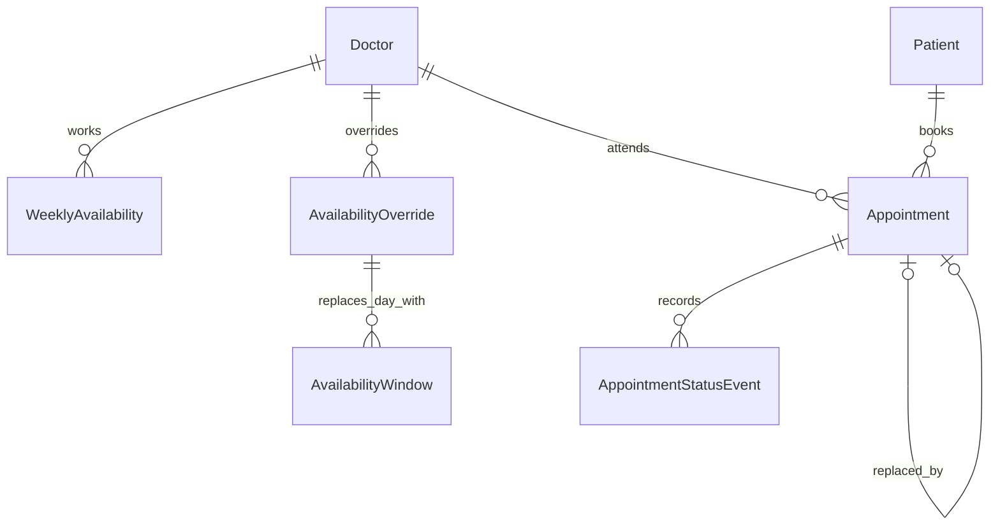

# M1 domain model

Terms are defined in [GLOSSARY.md](../GLOSSARY.md). Numbered decisions live in
[README section 8](../README.md#8-business-rules-and-assumptions).

| Entity | Meaning and representation |
| --- | --- |
| Doctor | UUID, name, speciality, 15/30-minute slot length, positive daily cap, active status |
| WeeklyAvailability | One doctor's ISO weekday and one half-open local-minute window |
| DateOverride / AvailabilityOverride | Unique doctor + local calendar date and reason; child windows replace the whole day |
| AvailabilityWindow | A window belonging to a date override; an empty parent's collection means leave |
| Patient | UUID, name, normalized unique E.164 phone, date-only DOB, assistance flags |
| Appointment | Doctor/patient references, UTC start/end, slot snapshot, status, reason, cancellation/deposit times, original reschedule reference |
| AppointmentStatusEvent | Booked creation or final-status event with occurrence instant; M2 must write it with the appointment transaction |

Pure TypeScript types and creation validators live under each feature's `domain/`
folder. `common/domain/validation.ts` contains actual shared value validation only.
Prisma persistence types stay outside domain code. API mappings and application
ports are added with their real consumers in M2/M3.

## Storage invariants

The initial SQL migration is generated from the Prisma schema, then extended with
named checks and GiST exclusion constraints. PostgreSQL `btree_gist` supplies UUID
and weekday comparisons. Half-open `tstzrange` constraints prevent occupied
appointments overlapping for a doctor or patient, including concurrent inserts.
Booked, Completed, and No-Show participate; both cancellation statuses release the
interval. Local-minute `int4range` constraints prevent overlapping weekly/override
windows. Adjacent intervals are permitted.

Other checks enforce positive caps, valid slot lengths/durations, non-empty text,
normalized phone format, non-future DOB, cancellation timestamp consistency, and
recorded event transitions. Foreign keys restrict deletion of history owners;
deleting a date override cascades only its own availability windows. Instants use
`timestamptz(3)`; DOB/override dates use `date`; recurring windows use local minutes.

These constraints do not enforce availability selection, grid alignment, daily
caps, penalty eligibility, horizon, lifecycle transitions of the appointment row,
or complete history writes. M2 must evaluate these under transaction-scoped
repositories with a consistent doctor/patient locking order or bounded serializable
retries. A preflight query alone is insufficient. The R1–R7 TODO inventory specifies
these gates without claiming them as implemented.

## Fictional seed catalog

Reference: **2026-10-19 08:30 IST** (`2026-10-19T03:00:00Z`).

- Two doctors: 15-minute cardiology and 30-minute general medicine, caps 12 and 8.
- Monday–Friday 09:00–12:00 and 14:00–17:00 local windows.
- Doctor one's leave on October 20; doctor two's extra Sunday clinic on October 25.
- Four explicitly fictional patients using reserved `+1 202-555-01xx` numbers.
- Nine appointments covering all five statuses, an acknowledged deposit case,
  a two-penalty patient, a one-penalty patient, and a linked reschedule.
- Fourteen status events, including initial booking history and final states.

`npm run prisma:seed` runs one transaction of stable-ID insert-if-missing upserts.
It preserves edits and never deletes records. A conflict with existing user data
rolls back the catalog transaction rather than silently rewriting it. Seed only
when explicitly requested; normal container startup runs migrations, not seed.
The reference is fixed so penalty/history examples do not change between runs.
The request-scoped review clock is still pending M3.

## Primary references

- [Prisma 7 migration workflow](https://www.prisma.io/docs/orm/v7/prisma-migrate/getting-started)
- [PostgreSQL range exclusion constraints](https://www.postgresql.org/docs/17/rangetypes.html#RANGETYPES-CONSTRAINT)
